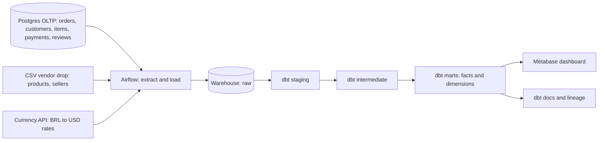
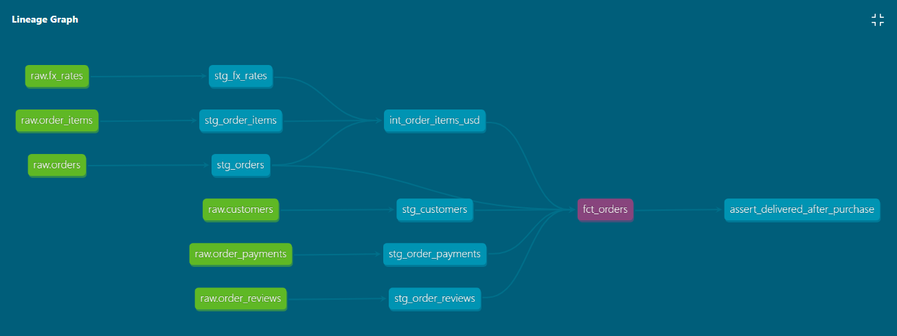
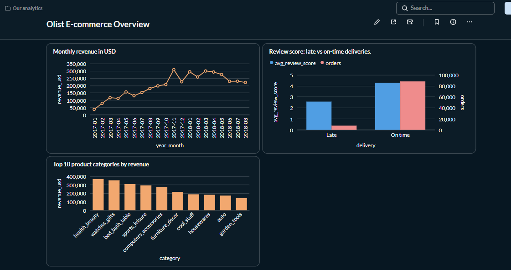

# Olist E-commerce ELT Platform


A batch ELT pipeline built from scratch on the public Olist Brazilian e-commerce dataset. Three different kinds of sources are loaded by **Airflow** into a **Postgres** warehouse, transformed by **dbt** into a tested star schema, and served through a **Metabase** dashboard. Everything runs locally with Docker Compose.

## Architecture



| Layer | Schema | Medallion | What happens |
|---|---|---|---|
| Raw | `raw` | Bronze | Data exactly as it arrived, plus `_loaded_at` / `_source_file` |
| Staging | `staging` | Silver | One model per raw table: rename, cast, deduplicate |
| Intermediate | `intermediate` | Silver | Joins and business logic (prices converted to USD at the purchase-date rate) |
| Marts | `marts` | Gold | Star schema: `fct_orders`, `fct_order_items`, `dim_customers`, `dim_products`, `dim_sellers`, `dim_date` |

## Orchestration

Four ingestion DAGs load the raw layer. When **all four** have finished, Airflow starts `dbt_build` by itself (Airflow Datasets), which builds every model and runs every test. If any task fails after its retries, a callback records it in `ops.pipeline_failures`.


| DAG | Source | Load strategy |
|---|---|---|
| `extract_orders_incremental` | Postgres | One-day window per run, delete and insert in one transaction (backfill-safe) |
| `extract_source_to_raw` | Postgres | Customers, items, payments, reviews: truncate and load |
| `load_vendor_files` | CSV drop folder | Truncate and load in one transaction, skipped if the file is missing |
| `load_fx_rates` | REST API (Frankfurter) | Upsert on (date, base, quote) |
| `dbt_build` | n/a | Runs `dbt build`, triggered by the four datasets |

## Data quality

- **59 dbt tests**: `unique`, `not_null`, `relationships` (every foreign key resolves), `accepted_values`, plus two custom tests (no order delivered before purchase, fact totals equal staging totals).
- A full `dbt build` is 75 checks (15 models, 1 seed, 59 tests).
- **CI** (GitHub Actions) lints the Python with `ruff` and runs the whole dbt project on a temporary Postgres loaded with a 300-order sample, on every push and pull request.



## Dashboard



## How to run it

1. Download the [Olist dataset from Kaggle](https://www.kaggle.com/datasets/olistbr/brazilian-ecommerce) and put the CSV files in `data/olist/`.
2. Simulate the vendor drop:
   ```
   copy data\olist\olist_products_dataset.csv data\vendor_drop\products.csv
   copy data\olist\olist_sellers_dataset.csv data\vendor_drop\sellers.csv
   ```
3. Start everything:
   ```
   docker compose up -d --build
   ```
4. Open Airflow at http://localhost:8080 (user `admin`, password `admin`), unpause the DAGs and trigger the three full-load DAGs and `load_fx_rates`.
5. Load the order history (one run per day):
   ```
   docker compose exec airflow-scheduler airflow dags backfill extract_orders_incremental --start-date 2016-09-01 --end-date 2018-10-31 --yes
   ```
6. `dbt_build` starts automatically once all four sources are loaded.
7. Optional: dashboard with `docker compose --profile bi up -d metabase` (http://localhost:3000), connected to host `warehouse-db`, port `5432`, database `olist_dw`, user and password `warehouse`.
8. Optional: dbt docs with `docker compose run --rm dbt docs generate`, then `docker compose run --rm -p 8081:8080 dbt docs serve --host 0.0.0.0 --port 8080`.

## Design decisions and lessons

- [Design decisions and tradeoffs](docs/design-decisions.md): grain, keys, incremental vs full refresh, idempotency.
- [What broke and how I fixed it](docs/what-broke-and-how-i-fixed-it.md): real problems I hit and how I solved them.

## Known limitations

- The data is a fixed historical dataset, so the daily schedules mostly reload the same data. The schedules demonstrate the mechanism, not real freshness.
- `fct_order_items` is incremental with a 3-day lookback, so later changes to older orders (for example a status change) are not picked up until a full refresh.
- Passwords in this repository are development defaults for a local project, never for production.
- The warehouse is Postgres. Porting the dbt project to BigQuery is a possible next step.

## Tech stack

Docker Compose, Apache Airflow 2.10, PostgreSQL 16, dbt Core 1.12 (dbt-postgres), Metabase, GitHub Actions, Python 3.11.